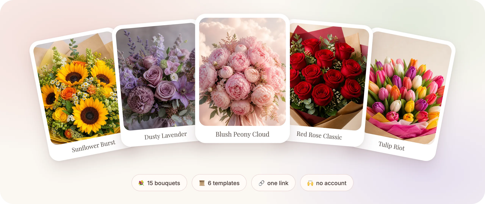
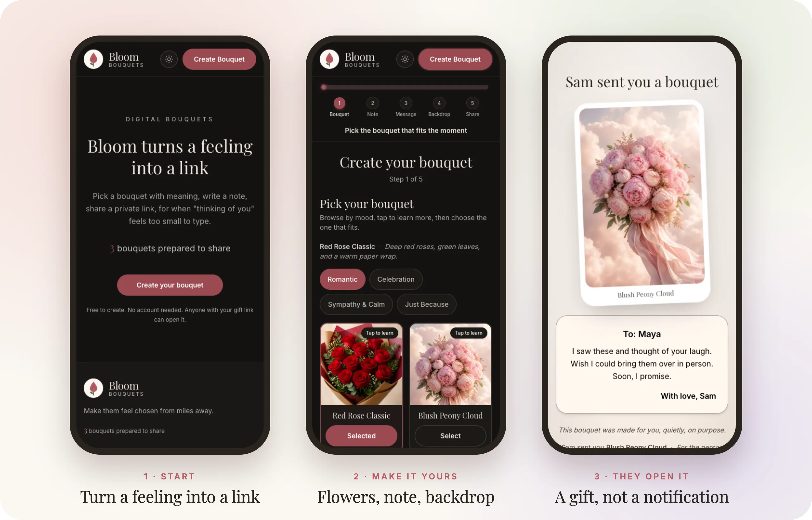

<div align="center">

# 💐 Bloom

### Flowers for the distance. Words that make it personal.

A digital bouquet, a note in your own words, and a link that opens like a gift.
No account. No app to install. Just a small way to show up.

**[🌷 Open Bloom](https://bloom-delta-nine.vercel.app) · [🛠️ Run locally](#grow-it-locally) · [📓 Project notebook](./docs/README.md)**



*For birthdays. For random Tuesdays. For “wish I could bring these over.”*

</div>

---

## ✨ A little gesture, made by you

Not a checkout for physical flowers. Not a greeting-card attachment.
Bloom lets you compose a small digital moment and send it wherever a link can go.

| 🌷 Choose the flowers | ✍️ Make the note yours | 🌙 Set the atmosphere |
| :--- | :--- | :--- |
| Pick from 15 bouquet arrangements, from a single poppy to a burst of sunflowers. | Choose stationery and a border, then write a formatted note of 2–200 words. Stuck? Optional prompts, like *Why I chose these*, help you start. | Pick a backdrop and, if it fits the moment, optional ambient sound. |

<p align="center">
  
</p>

### One thoughtful flow. Five steps.

**💐 Bouquet → 💌 Card → ✍️ Message → 🌅 Atmosphere → 🔗 Share**

Not sure where to begin? 📜 **[Templates](https://bloom-delta-nine.vercel.app/templates)**
offer six occasion starters, from a birthday to "just because", that open
straight at the note with flowers and style already picked. Every detail stays
yours to change.

### 🔗 Sending it

One main button does the work: **Share bouquet** opens your phone's share sheet,
or **Copy message + link** where a share sheet isn't available. **More ways to share**
tucks away the other copy options. If sharing or copying fails, a selectable link
appears so you are never stuck.

Bloom creates the gift link; it doesn't send an email or confirm that someone
received it. Shared links show a proper preview card in chat apps. 🖼️

### On the other side of the link…

1. **The flowers arrive.** A staged reveal gives the bouquet its own moment.
2. **The card follows.** The recipient opens the note rather than landing on a wall of text.
3. **The words stay.** They can save a PNG keepsake or create a bouquet in return.

No registration gate between the recipient and the gift. 🙌

## 🌿 Wander before you write

Browse without starting a bouquet. Each page ends with an invitation to Templates.

| Page | What you'll find |
| :--- | :--- |
| 💐 [Flowers](https://bloom-delta-nine.vercel.app/flowers) | Every bouquet, what it says, and when it fits |
| 💌 [Note styles](https://bloom-delta-nine.vercel.app/note-styles) | Stationery and border previews |
| 🌅 [Backdrops](https://bloom-delta-nine.vercel.app/backdrops) | The scenes your gift can open in |
| 🎵 [Ambient sound](https://bloom-delta-nine.vercel.app/ambient-sound) | Tracks you can listen to before choosing (only on tap) |
| 📜 [Templates](https://bloom-delta-nine.vercel.app/templates) | Editable occasion starters |

## 🧵 The details behind the gesture

The small things are part of the product, not just the decoration.

| Detail | What Bloom does |
| :--- | :--- |
| 📝 **An unfinished note is still your note** | Saves the draft and current builder step in this browser for 24 hours after the last edit. Starting a new bouquet asks before replacing it. |
| ✂️ **A limit without the scissors** | Keeps over-limit text intact, shows how many words to remove, and blocks Continue outside 2–200 words. No silent trimming. |
| 🎨 **Formatting that travels** | Preserves supported rich text and line breaks in the shared gift and PNG. |
| 🖼️ **A keepsake, not a recording** | Exports the bouquet, stationery, border, note, and backdrop as a still image. Motion is frozen; audio and the watercolor blur overlay are omitted. |
| 🔈 **Sound is optional** | Rain, piano, instrumental, and other ambient tracks load only when played, with a visible retry if playback fails. |
| 🪶 **Light on mobile data** | Optimized bouquet images and on-demand note fonts keep home, create, and an unopened gift under 500 KB on a phone. |
| ♿ **More than mouse clicks** | Rounded, touch-sized controls with keyboard support, visible focus, and reduced-motion support. Not certified on every device or assistive technology. |

## 🔍 A link is not a locked envelope

Bloom is account-free, but that does **not** make a gift private or encrypted.

- The gift's selections, names, and note are compressed into its URL—not stored as an account-backed gift record.
- Anyone with that link can open or forward it. There is no password, expiry, or revocation.
- Current gift URLs use a query parameter, so hosting services and link-preview tools may receive the contents. Browser history and messaging apps may retain the link.
- Drafts stay in local browser storage. If storage is blocked, the builder warns you to keep the page open until you copy the link.

**Avoid sensitive information in a bouquet.** The in-app [privacy page](https://bloom-delta-nine.vercel.app/privacy) explains the boundaries in more detail.

<a id="grow-it-locally"></a>

## 🛠️ Grow it locally

Use **Node.js 20** (the CI baseline) and **pnpm 9.15.9** (the pinned package manager).

```bash
git clone https://github.com/D-Kumar19/bloom.git
cd bloom
pnpm install
cp .env.example .env.local
pnpm dev
```

Open **http://localhost:3000**. Redis is optional for local development;
without credentials, the counter uses a development-only local file.

<details>
<summary><strong>🧪 Checks before a release</strong></summary>

```bash
pnpm test:run
pnpm type-check
pnpm lint
pnpm build
```

`pnpm test` starts Vitest in watch mode; `pnpm test:run` runs it once.
GitHub CI runs these checks on every pull request and also builds the Docker
image on `main`. Actions are SHA-pinned; the [draft release workflow](./docs/releases.md)
requires passing CI for the exact commit and never publishes or deploys automatically.

These are automated checks, not certification of every mobile browser or the
deployed site.

</details>

<details>
<summary><strong>🏗️ Under the petals: how it works</strong></summary>

**Next.js 16 · React 19 · TypeScript · Tailwind CSS 4 · Vitest**

```text
Builder edits → browser draft
              → compressed gift URL → recipient reveal
                                    → static PNG snapshot

Share action → counter API → Redis in production
```

- **Gift transport:** `lz-string` compresses the gift into a shareable URL. The recipient reconstructs it without an account lookup.
- **Image export:** `html2canvas` captures a static composition using the bouquet, note, and backdrop components.
- **Counter:** the first successful share or copy records a bouquet prepared to share, whichever button is used. A stable random gift ID survives edits/reloads; Redis atomically deduplicates it and enforces 10 requests per fixed minute and 50 per fixed hour per hashed client IP. Retries cannot increment the same gift again.
- **Counter caveat:** this is not proof of delivery or unique recipients. The historical total is retained under its earlier rules. Sharing never waits for counting; Redis failure shows an unavailable statistic, not a made-up zero. A Vercel Firewall rule also caps `POST /api/count` at 20 per minute per IP; see [counter policy](./docs/counter.md).

| Location | Responsibility |
| :--- | :--- |
| [`app/`](./app/) | Pages, recipient entry point, metadata, and API routes |
| [`components/`](./components/) | Builder controls, gift presentation, and shared UI |
| [`hooks/`](./hooks/) | Builder state and browser-side behavior |
| [`lib/`](./lib/) | Gift encoding, message handling, storage, audio, and export |
| [`public/`](./public/) | Bouquet artwork, flowers, and ambient tracks |
| [`docs/`](./docs/) | Backlog, release notes, counter operations, and product decisions |

</details>

<details>
<summary><strong>🚀 Deploying the counter without starting from zero</strong></summary>

Production requires **one complete writable credential pair**:

- `KV_REST_API_URL` + `KV_REST_API_TOKEN`, **or**
- `UPSTASH_REDIS_REST_URL` + `UPSTASH_REDIS_REST_TOKEN`.

See [`.env.example`](./.env.example). Never expose these tokens through a
`NEXT_PUBLIC_` variable or commit them.

Also configure `COUNTER_RATE_LIMIT_SECRET` (at least 32 random characters)
and a Vercel Firewall rate-limit rule for `POST /api/count`; see the
[counter checklist](./docs/counter.md). Application limits protect increments,
but each valid request still reaches Redis unless the edge blocks it first.

Keep the same Redis store and `bouquet:count` key across releases so the total
survives. Production does not fall back to a temporary file when Redis is
missing or unavailable. Use a separate Redis store for Preview deployments.

</details>

## 🧭 Where Bloom goes next

The core experience is shipped and verified in production. What comes next is
deliberately small and optional. More choices are not automatically a better gift.

| ✅ Shipped | 🌱 Being considered, not built |
| :--- | :--- |
| Draft recovery, faithful notes and PNGs, accessible soft UI | 📧 Email-ready sharing (compose links, no server email) |
| Templates and the Wander discovery pages | 👤 Optional accounts and a private bouquet journey |
| One-tap sharing, link previews, lighter pages | 🎙️ Photo or voice notes, only after a privacy and cost review |
| A persistent, abuse-limited share counter | 💡 Smaller ideas like QR codes or a sender name |

There are no accounts, automatic email delivery, or journey timelines today.
See [releases](./docs/releases.md) for what changed in each version.

**[📋 All TODOs and acceptance criteria](./docs/backlog.md)** ·
**[🔎 Audit findings](./docs/audit.md)** ·
**[📦 Releases](./docs/releases.md)** ·
**[🌱 Product principles](./docs/product-direction.md)**

---

<div align="center">

**It won't replace showing up in person.**

But “I'm thinking of you” deserves more than a notification. 💐

</div>
